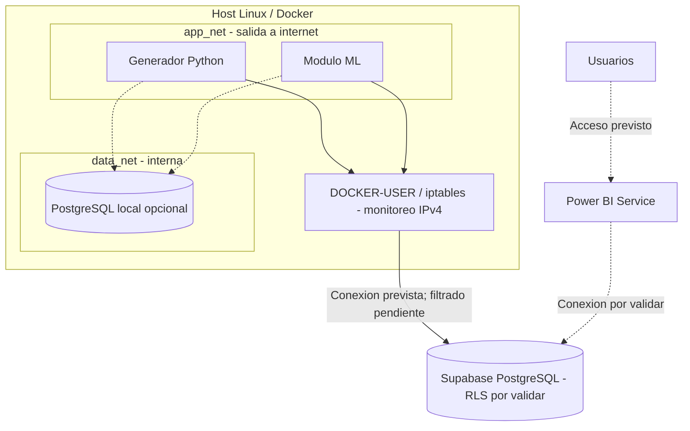

# Diagrama de red

Nota: Generador y ML pertenecen a ambas redes Docker. Las conexiones punteadas representan servicios opcionales o pendientes de validar. El firewall del proyecto funciona en modo observacion cuando se activa; no restringe exclusivamente la salida hacia Supabase.
